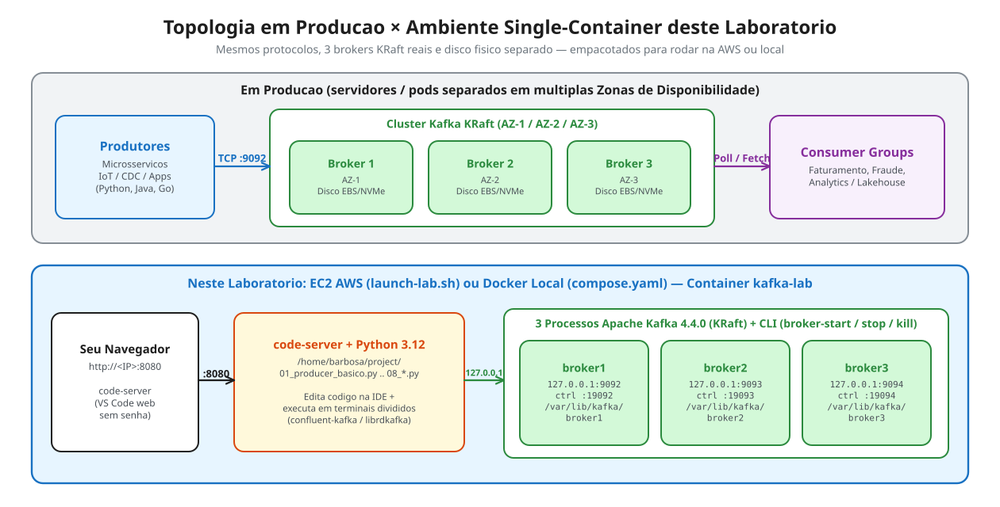
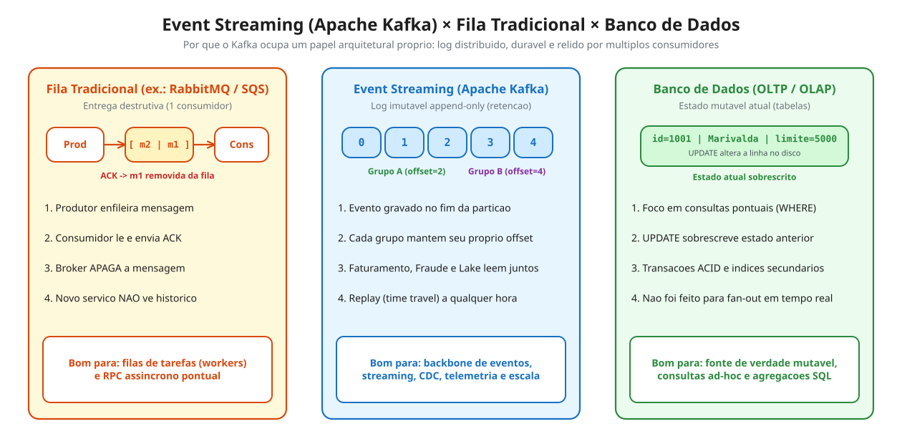
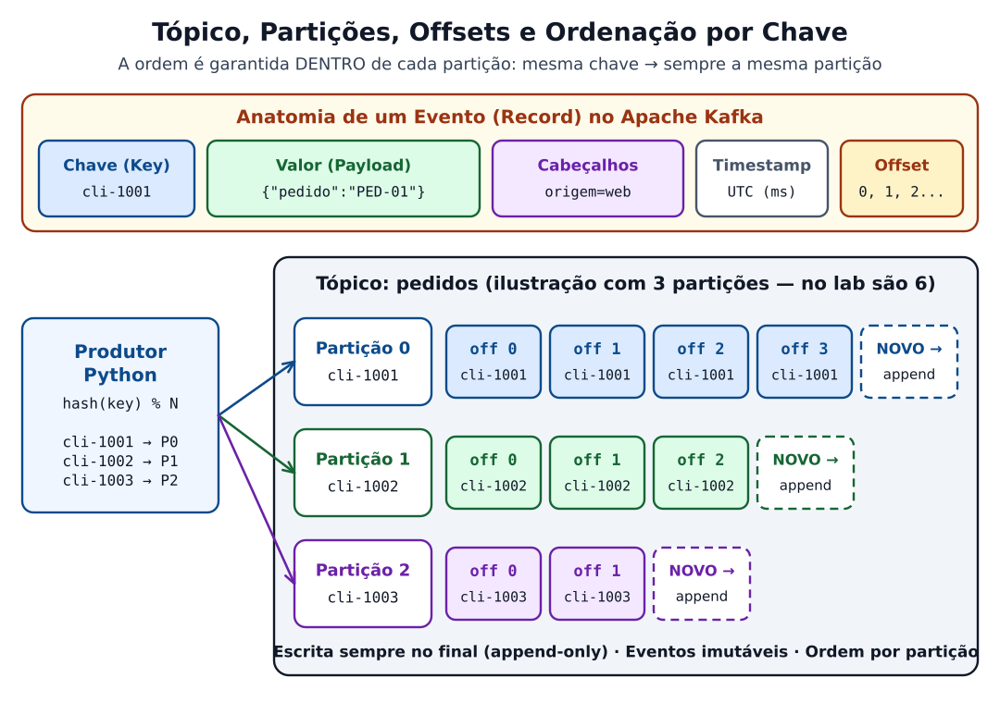
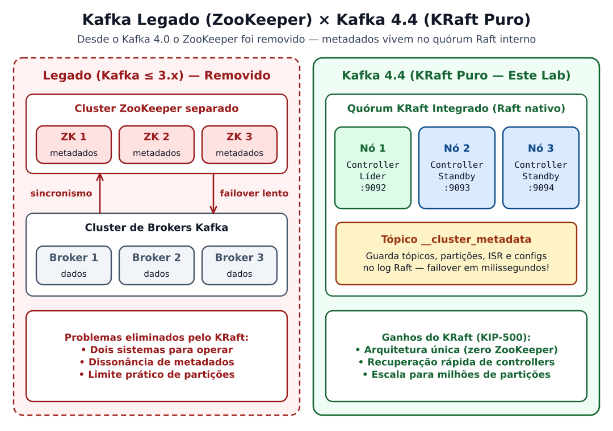
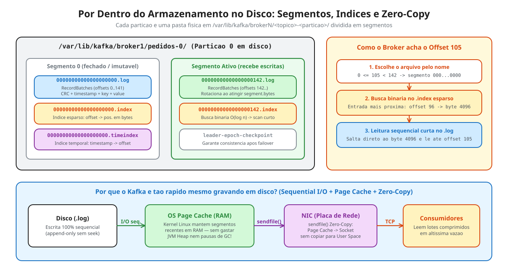
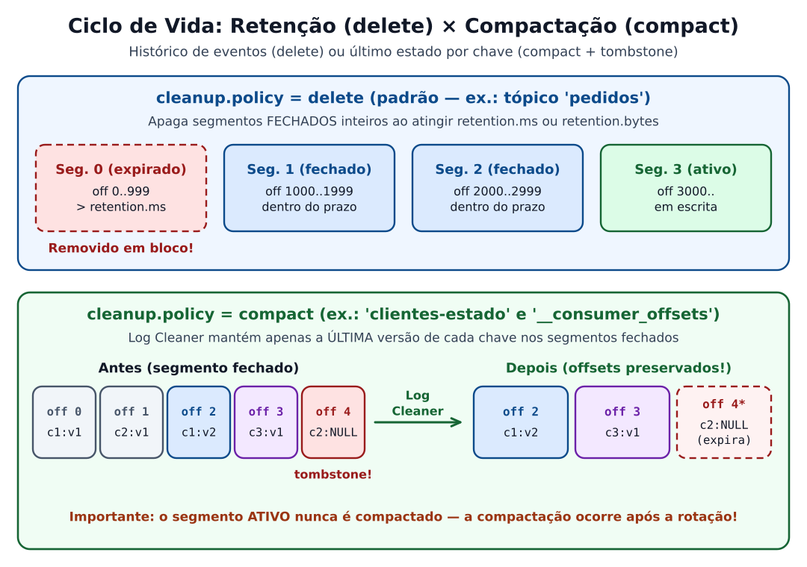
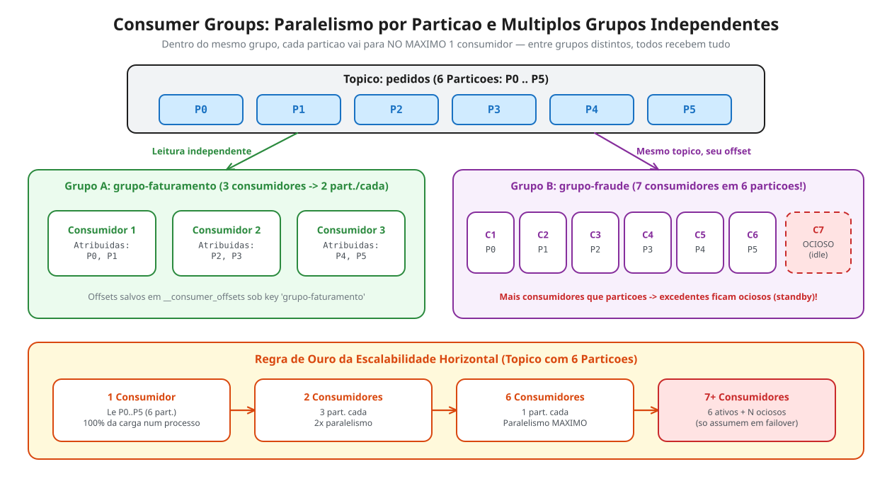
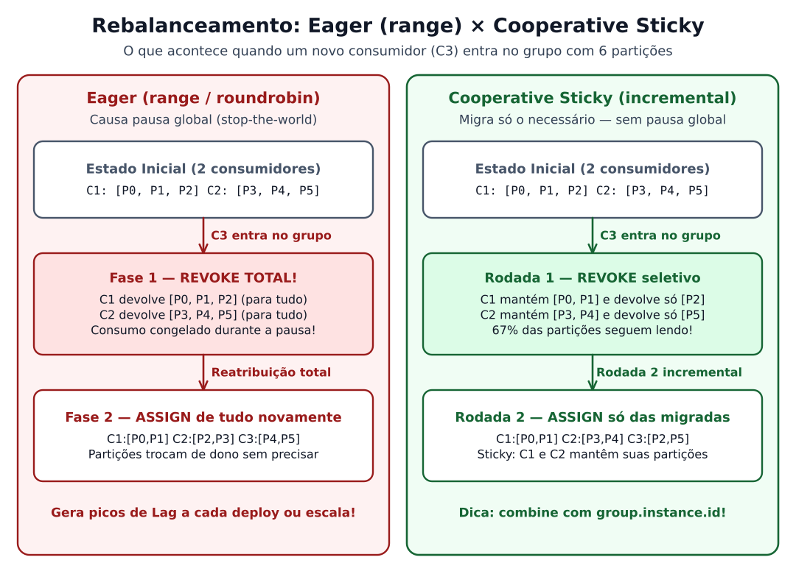
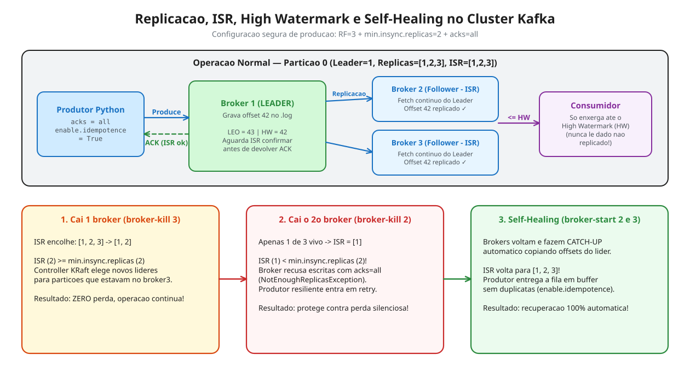
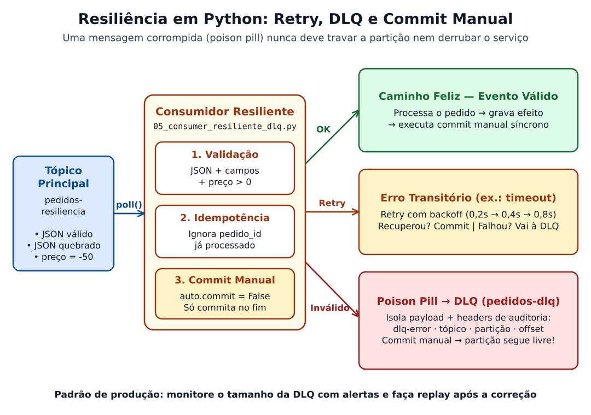

# Apache Kafka na Prática: Arquitetura KRaft, Armazenamento, Consumer Groups, Resiliência e Benchmark em Python

Author: Prof. Barbosa<br>
Contact: infobarbosa@gmail.com<br>
GitHub: [infobarbosa](https://github.com/infobarbosa)<br>
LinkedIn: [infobarbosa](https://www.linkedin.com/in/infobarbosa)

Este laboratório oferece uma imersão prática e conceitual completa no **Apache Kafka 4.4 (KRaft puro, sem ZooKeeper)** com foco na linguagem **Python (`confluent-kafka`)** e operação direta via **`code-server`**.

Em vez de tratar o Kafka como uma "caixa-preta que envia e recebe 10 mensagens", você vai operar um **cluster real de 3 brokers KRaft**, explorar a fundo a linha de comando (`kafka-console-producer.sh` e `kafka-console-consumer.sh`), **abrir os arquivos físicos da partição no disco** (`.log`, `.index`, `.timeindex` e `hexdump` byte a byte), testar **Log Compaction**, escalar e rebalancear **Consumer Groups**, derrubar brokers e consumidores para ver **resiliência e self-healing** em ação (incluindo *Dead Letter Queue*) e conduzir um **benchmark em escala de 200.000 mensagens**.

Os comandos são copy-paste no terminal do `code-server`, na ordem em que aparecem.

---

## O que você vai saber fazer ao final

- Explicar quando usar (e quando **não** usar) Apache Kafka em comparação com filas tradicionais e bancos de dados.
- Operar e diagnosticar um **cluster Kafka 4.x em modo KRaft** (sem ZooKeeper), inspecionando o quórum Raft e o tópico interno `__cluster_metadata`.
- Dominar `kafka-console-producer.sh` e `kafka-console-consumer.sh` do básico ao avançado (chaves, headers, propriedades do produtor, leitura cirúrgica por partição/offset, grupos via CLI, *tombstones* e leitura de `__consumer_offsets`).
- Desenvolver, editar no `code-server` e executar produtores e consumidores em **Python (`confluent-kafka`)** ajustando os principais parâmetros de durabilidade, latência e throughput.
- Inspecionar o **modelo físico de armazenamento em disco**: segmentos `.log`, índices esparsos `.index`/`.timeindex`, rotação de segmentos, `hexdump` de *RecordBatches*, compressão (`none` × `lz4` × `zstd`) e compactação (`cleanup.policy=compact`).
- Projetar e operar **Consumer Groups** entendendo paralelismo por partição, consumidores ociosos, múltiplos grupos independentes, rebalanceamento *Eager* × *Cooperative Sticky*, *Consumer Lag* e *Replay*.
- Validar **resiliência e self-healing** sob falhas reais: parada controlada (`broker-stop`), queda abrupta (`broker-kill`), perda de quórum (`min.insync.replicas`), failover de Controller KRaft, *catch-up* automático e **Dead Letter Queue (DLQ)** para *poison pills*.
- Medir **throughput, vazão (MiB/s), latência (`p50`/`p95`/`p99`) e uso real de disco** em um benchmark de **200.000 mensagens**.

---

## Pré-requisitos

- Acesso ao **AWS Academy** (o ambiente é uma instância EC2 provisionada automaticamente por script, logo abaixo).
- Um navegador web. Nada precisa ser instalado localmente: o cluster Kafka de 3 nós, o `code-server` e o ambiente Python com `confluent-kafka` já vêm prontos no container.

Fora da aula, o mesmo ambiente roda em qualquer máquina com **Docker**. Veja o [Apêndice A — Execução Local](#apêndice-a--execução-local).

---

## Índice

- [O ambiente](#o-ambiente)
  - [Passo 1: Abrir o AWS CloudShell](#passo-1-abrir-o-aws-cloudshell)
  - [Passo 2: Executar o script de provisionamento](#passo-2-executar-o-script-de-provisionamento)
  - [Passo 3: Acessar a IDE (code-server)](#passo-3-acessar-a-ide-code-server)
  - [Retomando o laboratório](#retomando-o-laboratório)
  - [Mapa dos 3 brokers e ferramentas do laboratório](#mapa-dos-3-brokers-e-ferramentas-do-laboratório)
- **Parte 1 — Fundamentos Conceituais e Cluster KRaft**
  - [1. Event Streaming, Tópicos, Partições e Log Imutável](#1-event-streaming-tópicos-partições-e-log-imutável)
  - [2. Arquitetura de Cluster em Modo KRaft (sem ZooKeeper)](#2-arquitetura-de-cluster-em-modo-kraft-sem-zookeeper)
- **Parte 2 — Hands-on na CLI e em Python no `code-server`**
  - [3. Tópicos e Prática Robusta com `kafka-console-producer.sh` e `kafka-console-consumer.sh`](#3-tópicos-e-prática-robusta-com-kafka-console-producersh-e-kafka-console-consumersh)
  - [4. Produtor e Consumidor em Python (`confluent-kafka`) no `code-server`](#4-produtor-e-consumidor-em-python-confluent-kafka-no-code-server)
- **Parte 3 — Por Dentro do Modelo de Armazenamento (Disco)**
  - [5. Anatomia Física no Disco: `.log`, `.index`, `.timeindex`, Rotação e `hexdump`](#5-anatomia-física-no-disco-log-index-timeindex-rotação-e-hexdump)
  - [6. Retenção (`delete`) × Compactação (`compact`) e Tombstones](#6-retenção-delete--compactação-compact-e-tombstones)
- **Parte 4 — Visão Aprofundada de Consumer Groups**
  - [7. Escalabilidade, Rebalanceamento, `__consumer_offsets`, Lag e Replay](#7-escalabilidade-rebalanceamento-__consumer_offsets-lag-e-replay)
- **Parte 5 — Principais Parâmetros do Produtor e do Consumidor**
  - [8. Guia de Tuning e Experimentos no Editor](#8-guia-de-tuning-e-experimentos-no-editor)
- **Parte 6 — Resiliência e Self-Healing (Cluster e Aplicação Python)**
  - [9. Caos no Cluster: Controlled Shutdown, Queda Abrupta, Quórum e Autocura](#9-caos-no-cluster-controlled-shutdown-queda-abrupta-quórum-e-autocura)
  - [10. Resiliência na Aplicação Python: Idempotência, Retry, DLQ e Failover de Consumidor](#10-resiliência-na-aplicação-python-idempotência-retry-dlq-e-failover-de-consumidor)
- **Parte 7 — Benchmark em Escala (200.000 Mensagens)**
  - [11. Medindo Throughput, Latência, Compressão em Disco e Consumo Paralelo](#11-medindo-throughput-latência-compressão-em-disco-e-consumo-paralelo)
- [Referências para Aprofundamento](#referências-para-aprofundamento)
- [Apêndice A — Execução Local](#apêndice-a--execução-local)
- [Apêndice B — Troubleshooting](#apêndice-b--troubleshooting)

---

## O ambiente

Este laboratório é executado em uma instância **AWS EC2** (`t3.medium`, 2 vCPU, 4 GiB RAM) provisionada automaticamente via **AWS CloudShell**.<br>
A instância executa um único container Docker (`kafka-lab`) com:

- **`code-server`** (Visual Studio Code direto no navegador, porta `8080`, sem senha), abrindo `/home/barbosa/project` já com os scripts Python prontos para editar e executar;
- **Cluster real de 3 brokers Apache Kafka 4.4.0 em modo KRaft** (sem ZooKeeper), cada um com sua própria porta e seu próprio diretório de dados em `/var/lib/kafka/broker{1,2,3}`;
- **Python 3.12 + `confluent-kafka`** (`librdkafka` em C) e ferramentas de administração/inspeção (`kafka-*.sh`, `cluster-status`, `broker-start/stop/kill`, `hexdump`, `jq`).



> **ATENÇÃO:**
> 1. **Região:** Utilize sempre a região **Norte da Virgínia (`us-east-1`)** no Console AWS.
> 2. **Custos:** A instância EC2 e o volume EBS consomem créditos do seu laboratório AWS Academy. Ao encerrar a aula, garanta que a instância esteja parada (**Stopped**) ou aguarde o desligamento automático da sessão.
> 3. **Não recrie a máquina para continuar o trabalho:** cada execução do `launch-lab.sh` cria uma instância **nova e vazia**, com data e hora no nome. Para continuar depois, siga [Retomando o laboratório](#retomando-o-laboratório).

### Passo 1: Abrir o AWS CloudShell
1. Faça login no Console da AWS através do seu painel do AWS Academy.
2. Certifique-se de que a região selecionada no canto superior direito é **N. Virginia (`us-east-1`)**.
3. No topo do console, clique no ícone do **AWS CloudShell** (`>_`) ao lado da barra de pesquisa.
4. Aguarde o terminal do CloudShell carregar.

### Passo 2: Executar o script de provisionamento
No terminal do CloudShell, execute:
```sh
curl -sS https://raw.githubusercontent.com/infobarbosa/kafka-tutorial/master/launch-lab.sh | bash
```

O script realizará automaticamente:
- Descoberta da VPC padrão e de uma Subnet pública numa AZ com oferta de `t3.medium`.
- Criação do Security Group `lab-kafka-sg` liberando as portas `8080` (IDE) e `22` (SSH).
- Lançamento de uma nova instância EC2 `lab-kafka-tutorial-AAAA-MM-DD_HH_MI_SS` (`t3.medium`, Ubuntu 24.04 LTS, 20 GB gp3).
- Instalação do Docker e inicialização do container `kafka-lab` (code-server + 3 brokers KRaft + Python).
- Exibição do IP público e do link de acesso da IDE.

### Passo 3: Acessar a IDE (code-server)
1. Abra no navegador o link exibido ao final do script: `http://<IP-PUBLICO>:8080`.
2. Caso a página não responda imediatamente, **aguarde de 3 a 5 minutos** para que o Docker conclua o download da imagem e suba os 3 brokers, e atualize o navegador (`Ctrl+F5`).
3. O `code-server` abrirá diretamente na pasta `/home/barbosa/project`, sem solicitar senha.
4. Abra um terminal integrado: menu superior (três linhas) > **Terminal** > **New Terminal** (ou atalho `` Ctrl+` ``).
   - Durante o laboratório, você usará tanto o **editor** (clicando nos arquivos `.py` no painel esquerdo para alterar parâmetros e salvar) quanto **múltiplos terminais lado a lado** (clique no ícone de dividir terminal — *Split Terminal* — para acompanhar produtor e consumidores simultaneamente).

Verifique se o ambiente, o cluster de 3 nós e o `confluent-kafka` estão prontos:
```sh
# 0.1
cluster-status
```

Output esperado (PIDs e `ClusterId` variam a cada execução):
```text
BROKER     ESTADO   PID      CLIENT_LISTENER   CTRL_LISTENER     LOG_DIR
------     ------   ---      ---------------   -------------     -------
broker1    UP       1584     127.0.0.1:9092    127.0.0.1:19092   /var/lib/kafka/broker1
broker2    UP       1583     127.0.0.1:9093    127.0.0.1:19093   /var/lib/kafka/broker2
broker3    UP       1582     127.0.0.1:9094    127.0.0.1:19094   /var/lib/kafka/broker3

=== Quorum KRaft (kafka-metadata-quorum.sh) ===
ClusterId:              GSga8lI7TOCumV2teTO8HA
LeaderId:               1
LeaderEpoch:            1
HighWatermark:          29
MaxFollowerLag:         0
MaxFollowerLagTimeMs:   0
CurrentVoters:          [{"id": 1, "endpoints": ["CONTROLLER://127.0.0.1:19092"]}, {"id": 2, "endpoints": ["CONTROLLER://127.0.0.1:19093"]}, {"id": 3, "endpoints": ["CONTROLLER://127.0.0.1:19094"]}]
CurrentObservers:       []
```

Confira também as versões do Kafka e do cliente Python:
```sh
# 0.2
kafka-topics.sh --version && \
python3 -c "import confluent_kafka; print('confluent-kafka:', confluent_kafka.__version__, '| librdkafka:', confluent_kafka.libversion()[0])"
```

Output esperado:
```text
4.4.0
confluent-kafka: 2.16.2 | librdkafka: 2.16.0
```

> **Atenção!** Todos os comandos deste tutorial devem ser executados no **terminal do `code-server`**. A variável de ambiente `$BOOTSTRAP_SERVERS` já vem exportada como `127.0.0.1:9092,127.0.0.1:9093,127.0.0.1:9094`.

### Retomando o laboratório
Se a sessão do AWS Academy expirar, a instância EC2 será parada. **Não execute o `launch-lab.sh` novamente** — ele criaria uma máquina nova e vazia.
1. No Console AWS (`us-east-1`), acesse **EC2** > **Instances**.
2. Selecione sua instância **`lab-kafka-tutorial-<data e hora>`** e clique em **Instance state** > **Start instance**.
3. Aguarde o estado **Running**, copie o novo **Public IPv4 address** e acesse `http://<NOVO_IP_PUBLICO>:8080`.
4. O container reinicia automaticamente preservando seus arquivos Python e os dados dos brokers.

### Mapa dos 3 brokers e ferramentas do laboratório

| Recurso | Valor no Container |
|---|---|
| `broker1` (broker + controller) | Cliente `127.0.0.1:9092` · Controller `127.0.0.1:19092` · Dados `/var/lib/kafka/broker1` |
| `broker2` (broker + controller) | Cliente `127.0.0.1:9093` · Controller `127.0.0.1:19093` · Dados `/var/lib/kafka/broker2` |
| `broker3` (broker + controller) | Cliente `127.0.0.1:9094` · Controller `127.0.0.1:19094` · Dados `/var/lib/kafka/broker3` |
| Variável `$BOOTSTRAP_SERVERS` | `127.0.0.1:9092,127.0.0.1:9093,127.0.0.1:9094` |
| Controle do cluster | `cluster-status`, `broker-stop <1\|2\|3>`, `broker-kill <1\|2\|3>`, `broker-start <1\|2\|3>` |
| Workspace no `code-server` | `/home/barbosa/project` (scripts `01_producer_basico.py` a `08_compaction_demo.py`) |

### Convenções
Cada bloco de comando traz na primeira linha um rótulo como `# 3.b.1`. Os blocos sem rótulo logo abaixo mostram a saída real esperada (valores dinâmicos como timestamps, PIDs, `TopicId` e a partição sorteada por hash podem variar ligeiramente).

---

# Parte 1 — Fundamentos Conceituais e Cluster KRaft

## 1. Event Streaming, Tópicos, Partições e Log Imutável

### O que é Event Streaming (e por que o Kafka não é apenas uma "fila")

O **Apache Kafka** nasceu no LinkedIn para resolver um problema clássico de arquiteturas modernas: dezenas de sistemas precisam publicar eventos contínuos (pedidos, pagamentos, cliques, sensores IoT, alterações de banco via CDC) e dezenas de outros sistemas precisam consumir **os mesmos eventos** em velocidades e momentos diferentes — com alta vazão, baixa latência e tolerância a falhas.

É muito comum confundir o Kafka com uma fila de mensagens tradicional (como RabbitMQ ou Amazon SQS) ou com um banco de dados. A figura abaixo resume a diferença estrutural entre os três modelos:



| Dimensão | Fila Tradicional (RabbitMQ / SQS) | Apache Kafka (Event Streaming) | Banco de Dados (OLTP / OLAP) |
|---|---|---|---|
| **Modelo de dados** | Fila transiente | **Log distribuído imutável (*append-only*)** | Tabelas mutáveis / colunas analíticas |
| **O que acontece após ler** | Mensagem é **removida** após o ACK | Evento **permanece no disco** até expirar a retenção | Linha permanece até `UPDATE`/`DELETE` |
| **Múltiplos leitores** | Precisa duplicar em filas/exchanges | **Nativo**: cada *Consumer Group* mantém seu próprio *offset* | Consultas concorrentes com `SELECT` |
| **Reprocessamento (Replay)** | Não (mensagem já foi apagada) | **Sim**: basta mover o offset para o passado | Sim, mas sem histórico completo por padrão |
| **Escala de escrita/leitura** | Dezenas de milhares msg/s | **Centenas de milhares a milhões msg/s** | Depende de índices, locks e transações |

> **Quando NÃO usar Kafka:** evite Kafka para consultas pontuais arbitrárias (`SELECT * FROM cliente WHERE cpf = ...`), transações ACID multi-tabela ou filas de tarefas simples com prioridade complexa por item e baixo volume — nesses casos, um banco relacional (PostgreSQL/MySQL) ou uma fila dedicada (RabbitMQ/SQS) entrega mais simplicidade operacional.

### Anatomia de um Evento, Tópicos, Partições e Chaves

No domínio deste laboratório — um **e-commerce em tempo real** — cada venda gera um **evento (*record*)** composto por:
- **Key (chave, opcional):** ex. `cli-1001`. Define **para qual partição** o evento vai (via hash determinístico).
- **Value (valor/payload):** os dados do evento em bytes (neste lab, JSON UTF-8).
- **Headers (cabeçalhos, opcionais):** metadados leves em pares chave-valor (ex.: `origem=checkout-web`, `schema-versao=1.0`, ou metadados de erro numa *Dead Letter Queue*).
- **Timestamp:** instante de criação (`CreateTime`) ou de gravação no broker (`LogAppendTime`).
- **Offset:** número inteiro sequencial (`0, 1, 2, ...`), atribuído pelo **broker líder da partição**, que identifica de forma única e imutável a posição daquele evento dentro daquela partição.



Duas propriedades fundamentais definem o comportamento do Kafka:
1. **A partição é a unidade de paralelismo e ordenação:** o Kafka garante ordem estrita **dentro de uma mesma partição**, e **não** ordem global entre partições diferentes.
2. **Mesma chave (`key`) = mesma partição:** quando todos os eventos de `cli-1001` carregam `key=cli-1001`, o particionador envia todos para a mesma partição, garantindo que `PEDIDO_CRIADO` → `PAGAMENTO_APROVADO` → `PEDIDO_ENVIADO` cheguem na ordem exata!

---

## 2. Arquitetura de Cluster em Modo KRaft (sem ZooKeeper)

Historicamente, o Apache Kafka dependia do **Apache ZooKeeper** para eleger o controller do cluster, guardar a lista de tópicos/partições/ISRs e gerenciar configurações. Isso trazia três dores crônicas em produção:
1. **Dois sistemas distribuídos diferentes** para instalar, monitorar, atualizar e proteger com TLS/Kerberos.
2. **Dissonância de metadados (*metadata split*):** o estado vivia no ZooKeeper, mas precisava ser sincronizado com os brokers — limitando a escala prática de partições e tornando failovers lentos.
3. **Complexidade operacional desnecessária** mesmo em clusters pequenos.

Com a **KIP-500**, nasceu o **KRaft (*Kafka Raft Metadata Mode*)** — e a partir do **Apache Kafka 4.0**, o ZooKeeper foi **removido definitivamente do código-fonte**. No Kafka 4.4 (que usamos neste laboratório), o próprio cluster mantém um quórum baseado no algoritmo de consenso **Raft** replicando todos os metadados no tópico interno **`__cluster_metadata`**:



No nosso container, os 3 nós operam em modo combinado (`process.roles=broker,controller`): um deles é eleito **Active Controller** (líder do quórum Raft) e os outros dois atuam como **Standby Controllers** com cópia quente em memória de `__cluster_metadata` — prontos para assumir a liderança em milissegundos em caso de falha!

### 2.a. Inspecionando o quórum KRaft e `__cluster_metadata` no disco

Verifique o estado de replicação entre os 3 voters do quórum KRaft:
```sh
# 2.a.1
kafka-metadata-quorum.sh --bootstrap-server "$BOOTSTRAP_SERVERS" describe --replication
```

Output esperado:
```text
NodeId	DirectoryId           	LogEndOffset	Lag	LastFetchTimestamp	LastCaughtUpTimestamp	Status  	
1     	AAAAAAAAAAAAAAAAAAAAAA	197         	0  	1795638950800     	1795638950800        	Leader  	
2     	AAAAAAAAAAAAAAAAAAAAAA	197         	0  	1795638950597     	1795638950597        	Follower	
3     	AAAAAAAAAAAAAAAAAAAAAA	197         	0  	1795638950597     	1795638950597        	Follower	
```

Repare que `Lag = 0` em todos os nós: os dois *Standby Controllers* estão sincronizados com o *Leader* até o último registro de metadados.

Agora veja onde esse log de metadados vive fisicamente no disco do `broker1` (sem precisar de `sudo`!):
```sh
# 2.a.2
ls -la /var/lib/kafka/broker1/__cluster_metadata-0
```

Output esperado:
```text
total 48
drwxr-x--- 2 kafka kafka     4096 Nov 25 20:34 .
drwxr-x--- 1 kafka kafka     4096 Nov 25 20:34 ..
-r-------- 1 kafka kafka      411 Nov 25 20:34 00000000000000000000-0000000000.checkpoint
-rw-r----- 1 kafka kafka 10485760 Nov 25 20:35 00000000000000000000.index
-rw-r----- 1 kafka kafka    15006 Nov 25 20:35 00000000000000000000.log
-rw-r----- 1 kafka kafka 10485756 Nov 25 20:35 00000000000000000000.timeindex
-rw-r----- 1 kafka kafka        8 Nov 25 20:34 leader-epoch-checkpoint
-rw-r----- 1 kafka kafka       43 Nov 25 20:34 partition.metadata
-rw-r----- 1 kafka kafka      153 Nov 25 20:34 quorum-state
```

Veja o arquivo `quorum-state` (é JSON puro!) que guarda a época atual da eleição Raft e os votantes:
```sh
# 2.a.3
cat /var/lib/kafka/broker1/__cluster_metadata-0/quorum-state | jq .
```

> **Percebeu a elegância do KRaft?** O próprio estado do cluster é armazenado no **mesmo formato de log de segmentos** (`.log`, `.index`, `.timeindex`) usado pelos seus tópicos de negócio — sem nenhum ZooKeeper por perto!

---

# Parte 2 — Hands-on na CLI e em Python no `code-server`

## 3. Tópicos e Prática Robusta com `kafka-console-producer.sh` e `kafka-console-consumer.sh`

Antes de escrever ou editar código Python, todo engenheiro de dados e plataforma precisa dominar as ferramentas oficiais de linha de comando do Kafka — elas são o "canivete suíço" para inspecionar tópicos, reproduzir bugs, injetar eventos de teste, checar headers e auditar partições em produção.

> **Novidade do Apache Kafka 4.x:** os antigos flags `--property` e `--producer-property` foram depreciados em favor das opções mais explícitas **`--reader-property`** (no produtor), **`--formatter-property`** (no consumidor) e **`--command-property`** (para configs de cliente como `acks` e `compression.type`). Neste laboratório usamos a sintaxe moderna do Kafka 4.4 — limpa e sem avisos de depreciação.

### 3.a. Criando e inspecionando tópicos no cluster de 3 nós

Neste cluster, `auto.create.topics.enable=false` (boa prática de produção: tópicos devem ser criados explicitamente com número planejado de partições e fator de replicação). Vamos criar nosso tópico principal `pedidos` com **6 partições**, **fator de replicação 3** e **`min.insync.replicas=2`**:

```sh
# 3.a.1
kafka-topics.sh --bootstrap-server "$BOOTSTRAP_SERVERS" \
  --create --topic pedidos \
  --partitions 6 \
  --replication-factor 3 \
  --config min.insync.replicas=2
```

Inspecione a distribuição de líderes e réplicas entre `broker1`, `broker2` e `broker3`:
```sh
# 3.a.2
kafka-topics.sh --bootstrap-server "$BOOTSTRAP_SERVERS" --describe --topic pedidos
```

Output esperado:
```text
Topic: pedidos	TopicId: 0kDtQ8jnSS6Mvk9LHYXW8g	PartitionCount: 6	ReplicationFactor: 3	Configs: min.insync.replicas=2
	Topic: pedidos	Partition: 0	Leader: 3	Replicas: 3,1,2	Isr: 3,1,2	Elr: 	LastKnownElr: 
	Topic: pedidos	Partition: 1	Leader: 1	Replicas: 1,2,3	Isr: 1,2,3	Elr: 	LastKnownElr: 
	Topic: pedidos	Partition: 2	Leader: 2	Replicas: 2,3,1	Isr: 2,3,1	Elr: 	LastKnownElr: 
	Topic: pedidos	Partition: 3	Leader: 2	Replicas: 2,1,3	Isr: 2,1,3	Elr: 	LastKnownElr: 
	Topic: pedidos	Partition: 4	Leader: 1	Replicas: 1,3,2	Isr: 1,3,2	Elr: 	LastKnownElr: 
	Topic: pedidos	Partition: 5	Leader: 3	Replicas: 3,2,1	Isr: 3,2,1	Elr: 	LastKnownElr: 
```

Repare no equilíbrio perfeito: cada broker (`1`, `2` e `3`) é **Leader** de exatamente 2 partições e **Follower** das outras 4, com `Isr` (In-Sync Replicas) completo nos 3 nós!

### 3.b. Nível 1 (Básico): publicação interativa/pipe e leitura com metadados

Envie 3 mensagens simples via pipe (ou abra de forma interativa removendo o `printf ... |` e encerrando com `Ctrl+D`):
```sh
# 3.b.1
printf "Pedido manual 1: GELADEIRA\nPedido manual 2: TELEVISOR\nPedido manual 3: MOUSE\n" | \
  kafka-console-producer.sh --bootstrap-server "$BOOTSTRAP_SERVERS" --topic pedidos
```

Se você rodar `kafka-console-consumer.sh` **sem** `--from-beginning`, ele começa a ouvir apenas eventos futuros (a partir do final atual do log). Para ler desde o início exibindo **timestamp, partição, offset e chave**:
```sh
# 3.b.2
kafka-console-consumer.sh --bootstrap-server "$BOOTSTRAP_SERVERS" \
  --topic pedidos \
  --from-beginning \
  --max-messages 3 \
  --timeout-ms 5000 \
  --formatter-property print.timestamp=true \
  --formatter-property print.partition=true \
  --formatter-property print.offset=true \
  --formatter-property print.key=true
```

Output esperado:
```text
CreateTime:1795638955935	Partition:5	Offset:0	null	Pedido manual 1: GELADEIRA
CreateTime:1795638955946	Partition:5	Offset:1	null	Pedido manual 2: TELEVISOR
CreateTime:1795638955946	Partition:5	Offset:2	null	Pedido manual 3: MOUSE
Processed a total of 3 messages
```

> **Repare em dois detalhes importantes:**
> 1. A chave apareceu como `null`, e as 3 mensagens caíram juntas na mesma partição (no exemplo, `Partition:5`) por causa do **Sticky Partitioner**, que agrupa mensagens sem chave no mesmo lote para reduzir chamadas de rede.
> 2. Combinar `--max-messages` + `--timeout-ms` evita que o comando fique travado esperando novas mensagens quando você só quer inspecionar uma amostra!

### 3.c. Nível 2 (Intermediário): Chaves (`key`), Headers e Propriedades do Produtor via CLI

Vamos criar um tópico dedicado `pedidos-cli` (3 partições, RF=3) para explorar recursos avançados do console producer e consumer sem misturar com o fluxo principal:
```sh
# 3.c.1
kafka-topics.sh --bootstrap-server "$BOOTSTRAP_SERVERS" \
  --create --topic pedidos-cli \
  --partitions 3 \
  --replication-factor 3 \
  --config min.insync.replicas=2
```

Agora vamos publicar eventos JSON com **Headers** (`origem` e `canal`) **+** **Chave (`cliente_id`)** **+** **configurações explícitas de produtor** (`acks=all`, `compression.type=lz4`, `linger.ms=10`) tudo numa única chamada CLI!

O formato de entrada quando `parse.headers=true` e `parse.key=true` é:
`header1:val1,header2:val2<TAB>chave:valor`

```sh
# 3.c.2
printf 'origem:web,canal:pix\tcli-1001:{"pedido_id":"CLI-001","produto":"GELADEIRA","preco":3299.90}\norigem:app,canal:cartao\tcli-1001:{"pedido_id":"CLI-002","produto":"MOUSE","preco":149.90}\norigem:web,canal:boleto\tcli-1002:{"pedido_id":"CLI-003","produto":"COMPUTADOR","preco":4890.00}\norigem:api,canal:pix\tcli-1001:{"pedido_id":"CLI-004","produto":"TELEVISOR","preco":2499.00}\n' | \
  kafka-console-producer.sh --bootstrap-server "$BOOTSTRAP_SERVERS" \
  --topic pedidos-cli \
  --reader-property parse.headers=true \
  --reader-property headers.key.separator=: \
  --reader-property parse.key=true \
  --reader-property key.separator=: \
  --command-property acks=all \
  --command-property compression.type=lz4 \
  --command-property linger.ms=10
```

Agora leia exibindo partição, offset, headers, chave e um separador visual personalizado (`" => "`):
```sh
# 3.c.3
kafka-console-consumer.sh --bootstrap-server "$BOOTSTRAP_SERVERS" \
  --topic pedidos-cli \
  --from-beginning \
  --max-messages 4 \
  --timeout-ms 5000 \
  --formatter-property print.partition=true \
  --formatter-property print.offset=true \
  --formatter-property print.headers=true \
  --formatter-property print.key=true \
  --formatter-property key.separator=" => "
```

Output esperado:
```text
Partition:1 => Offset:0 => origem:web,canal:pix => cli-1001 => {"pedido_id":"CLI-001","produto":"GELADEIRA","preco":3299.90}
Partition:1 => Offset:1 => origem:app,canal:cartao => cli-1001 => {"pedido_id":"CLI-002","produto":"MOUSE","preco":149.90}
Partition:1 => Offset:2 => origem:web,canal:boleto => cli-1002 => {"pedido_id":"CLI-003","produto":"COMPUTADOR","preco":4890.00}
Partition:1 => Offset:3 => origem:api,canal:pix => cli-1001 => {"pedido_id":"CLI-004","produto":"TELEVISOR","preco":2499.00}
Processed a total of 4 messages
```

Observe que **todos os 3 eventos de `cli-1001`** (`CLI-001`, `CLI-002` e `CLI-004`) foram gravados exatamente na **mesma partição** (`Partition:1`), preservando a ordem cronológica absoluta do cliente!

### 3.d. Nível 3 (Avançado): Consumer Group via CLI, Leitura Cirúrgica (Partição/Offset), Tombstone e Ingestão de Arquivo

#### 1) Consumindo com `--group` explícito e auditando offsets
Quando você passa `--group`, o `kafka-console-consumer.sh` se comporta como um membro real de um Consumer Group e salva seus offsets no cluster:
```sh
# 3.d.1
kafka-console-consumer.sh --bootstrap-server "$BOOTSTRAP_SERVERS" \
  --topic pedidos-cli \
  --group cli-auditoria-cg \
  --from-beginning \
  --timeout-ms 4000 \
  --formatter-property print.partition=true \
  --formatter-property print.offset=true \
  --formatter-property print.key=true || true
```

Verifique o offset gravado pelo grupo `cli-auditoria-cg`:
```sh
# 3.d.2
kafka-consumer-groups.sh --bootstrap-server "$BOOTSTRAP_SERVERS" --describe --group cli-auditoria-cg
```

Output esperado:
```text
GROUP            TOPIC           PARTITION  CURRENT-OFFSET  LOG-END-OFFSET  LAG             CONSUMER-ID     HOST            CLIENT-ID
cli-auditoria-cg pedidos-cli     0          0               0               0               -               -               -
cli-auditoria-cg pedidos-cli     1          4               4               0               -               -               -
cli-auditoria-cg pedidos-cli     2          0               0               0               -               -               -
```

Se você rodar o comando `# 3.d.1` **uma segunda vez**, nenhuma mensagem será exibida porque `LAG = 0` — o grupo já commitou o offset `4` na partição `1`!

#### 2) Leitura cirúrgica em produção: partição exata + offset exato
Em incidentes reais ("o consumidor quebrou na partição 1, offset 2!"), você **não** quer ler o tópico inteiro desde o início — você vai direto no ponto exato com `--partition` e `--offset`:
```sh
# 3.d.3
kafka-console-consumer.sh --bootstrap-server "$BOOTSTRAP_SERVERS" \
  --topic pedidos-cli \
  --partition 1 \
  --offset 1 \
  --max-messages 2 \
  --timeout-ms 4000 \
  --formatter-property print.offset=true \
  --formatter-property print.key=true
```

Output esperado (lê exatamente os offsets `1` e `2` da partição `1`):
```text
Offset:1	cli-1001	{"pedido_id":"CLI-002","produto":"MOUSE","preco":149.90}
Offset:2	cli-1002	{"pedido_id":"CLI-003","produto":"COMPUTADOR","preco":4890.00}
Processed a total of 2 messages
```

#### 3) Enviando um *Tombstone* (`value = null`) pela CLI
Um **tombstone** é um evento com chave definida e **valor nulo** — ele é o mecanismo oficial do Kafka para sinalizar "esta chave foi deletada" (usado em *Log Compaction* e em CDC como Debezium). Com `--reader-property null.marker=NULL`, você envia tombstones direto da linha de comando:
```sh
# 3.d.4
printf 'cli-1002:NULL\n' | \
  kafka-console-producer.sh --bootstrap-server "$BOOTSTRAP_SERVERS" \
  --topic pedidos-cli \
  --reader-property parse.key=true \
  --reader-property key.separator=: \
  --reader-property null.marker=NULL
```

Leia destacando visualmente valores nulos com `null.literal`:
```sh
# 3.d.5
kafka-console-consumer.sh --bootstrap-server "$BOOTSTRAP_SERVERS" \
  --topic pedidos-cli \
  --from-beginning \
  --max-messages 5 \
  --timeout-ms 4000 \
  --formatter-property print.offset=true \
  --formatter-property print.key=true \
  --formatter-property null.literal="<TOMBSTONE>"
```

Output esperado:
```text
Offset:0	cli-1001	{"pedido_id":"CLI-001","produto":"GELADEIRA","preco":3299.90}
Offset:1	cli-1001	{"pedido_id":"CLI-002","produto":"MOUSE","preco":149.90}
Offset:2	cli-1002	{"pedido_id":"CLI-003","produto":"COMPUTADOR","preco":4890.00}
Offset:3	cli-1001	{"pedido_id":"CLI-004","produto":"TELEVISOR","preco":2499.00}
Offset:4	cli-1002	<TOMBSTONE>
Processed a total of 5 messages
```

#### 4) Ingestão em lote a partir de arquivo JSONL (sem abrir editor)
Em tarefas de carga rápida ou reprocessamento, você pode redirecionar um arquivo inteiro para o `kafka-console-producer.sh`:
```sh
# 3.d.6
cat <<'EOF' > /tmp/lote_pedidos.txt
cli-1003:{"pedido_id":"BATCH-01","produto":"VENTILADOR","preco":229.00}
cli-1004:{"pedido_id":"BATCH-02","produto":"RELOGIO","preco":649.00}
cli-1005:{"pedido_id":"BATCH-03","produto":"FRITADEIRA ELETRICA","preco":459.90}
EOF

kafka-console-producer.sh --bootstrap-server "$BOOTSTRAP_SERVERS" \
  --topic pedidos-cli \
  --reader-property parse.key=true \
  --reader-property key.separator=: < /tmp/lote_pedidos.txt
```

---

## 4. Produtor e Consumidor em Python (`confluent-kafka`) no `code-server`

Agora vamos sair da CLI e programar em **Python** usando a biblioteca **`confluent-kafka`** (wrapper oficial sobre o motor nativo em C `librdkafka`, padrão de mercado por unir API Pythônica com altíssima performance e suporte completo a idempotência, compressão e rebalanceamento cooperativo).

### 4.a. Explorando e executando `01_producer_basico.py`

1. No painel lateral esquerdo do **`code-server`** (Explorer), clique em **`01_producer_basico.py`** para abrir o código-fonte no editor.
2. Observe no código:
   - O dicionário `config` com `bootstrap.servers`, `acks`, `enable.idempotence`, `linger.ms`, `batch.size`, `compression.type` e `retries`.
   - O callback `on_delivery(err, msg)` que confirma cada entrega assincronamente exibindo `P` (partição), `Offset`, `Key` e o resumo do pedido.
   - O loop de proteção contra `BufferError` + `producer.poll(0)` e o `producer.flush()` obrigatório no encerramento.

Execute o produtor com **chave (`key = cliente_id`)** para enviar 24 pedidos ao tópico `pedidos`:
```sh
# 4.a.1
python3 01_producer_basico.py --topico pedidos --mensagens 24 --intervalo 0.05
```

Output esperado (parcial):
```text
Produzindo 24 pedidos em 'pedidos' (acks=all, linger.ms=10, compression=lz4, chave=cliente_id)...
[ACK] P=5 | Offset=    3 | Key=cli-1004 | Pedido=PED-000001 | RELOGIO (R$ 649.00)
[ACK] P=3 | Offset=    0 | Key=cli-1005 | Pedido=PED-000007 | MAQUINA DE LAVAR (R$ 2150.00)
[ACK] P=2 | Offset=    0 | Key=cli-1001 | Pedido=PED-000008 | MOUSE (R$ 149.00)
...
--- Resumo da Producao ---
Entregues: 24 | Erros: 0 | Pendentes: 0 | Tempo: 1.42s
Distribuicao por particao: {2: 4, 3: 6, 4: 11, 5: 3}
```

> **Observe a distribuição por partição!** Como temos apenas 5 chaves (`cli-1001`..`cli-1005`) para 6 partições, **todo evento de `cli-1001` sempre caiu na mesma partição** (`P=2`), `cli-1005` sempre em `P=3`, e assim por diante. Isso também revela um fenômeno clássico de sistemas distribuídos: **chaves com baixa cardinalidade podem deixar partições subutilizadas ou gerar *hot partitions***.

Agora rode o mesmo script com **`--sem-chave`** (`key=None`) para observar o **Sticky Partitioner** espalhar lotes pelas 6 partições:
```sh
# 4.a.2
python3 01_producer_basico.py --topico pedidos --mensagens 24 --intervalo 0 --sem-chave --silencioso
```

> **Mão na massa no editor do `code-server`:** abra `01_producer_basico.py`, adicione um novo produto na lista `PRODUTOS` (por exemplo, `("CAFETEIRA EXPRESSO", "eletroportateis", 799.90)`) ou um novo header em `headers = [...]`, salve (`Ctrl+S` — o auto-save também está ativo) e execute novamente `# 4.a.1`!

### 4.b. Explorando e executando `02_consumer_basico.py`

1. Abra **`02_consumer_basico.py`** no editor do `code-server`.
2. Veja como o loop `consumer.poll(timeout=1.0)` lê mensagens, decodifica `key`, `headers` e o JSON de `value`, e chama `consumer.close()` no bloco `finally` para avisar imediatamente o broker que saiu do grupo (evitando esperar `session.timeout.ms`).

Execute o consumidor lendo as primeiras 10 mensagens do tópico `pedidos`:
```sh
# 4.b.1
python3 02_consumer_basico.py --topico pedidos --group grupo-basico-py --max-mensagens 10
```

Output esperado:
```text
Consumindo topico 'pedidos' no grupo 'grupo-basico-py' (auto.offset.reset=earliest). Ctrl+C para sair.
[MSG #   1] P=3 | Offset=    0 | Key=cli-1005 | Headers={'origem': 'checkout-web', 'schema-versao': '1.0'} | PED-000007 | MAQUINA DE LAVAR | R$ 2150.00 | UF=SP
[MSG #   2] P=3 | Offset=    1 | Key=cli-1005 | Headers={'origem': 'checkout-web', 'schema-versao': '1.0'} | PED-000012 | RELOGIO | R$ 649.00 | UF=RJ
...
[MSG #   8] P=5 | Offset=    0 | Key=None     | Headers={} | Pedido manual 1: GELADEIRA
[MSG #   9] P=5 | Offset=    1 | Key=None     | Headers={} | Pedido manual 2: TELEVISOR
[MSG #  10] P=5 | Offset=    2 | Key=None     | Headers={} | Pedido manual 3: MOUSE

Encerrando consumidor de forma limpa (total lidas: 10)...
```

---

# Parte 3 — Por Dentro do Modelo de Armazenamento (Disco)

## 5. Anatomia Física no Disco: `.log`, `.index`, `.timeindex`, Rotação e `hexdump`

Assim como abrimos páginas `.ibd` no MySQL, *SSTables* no Cassandra e arquivos Parquet no InfluxDB 3, agora vamos **descer até o sistema de arquivos dos brokers Kafka** para provar como os dados realmente moram no disco — e entender por que o Kafka atinge centenas de milhares de mensagens por segundo mesmo persistindo tudo em disco!

### Como uma partição é organizada fisicamente

Cada réplica de partição é um diretório no disco do broker: `/var/lib/kafka/broker<N>/<topico>-<particao>/`. Em vez de um único arquivo gigante (impossível de apagar/compactar com eficiência), o Kafka divide a partição em **segmentos** identificados pelo **offset inicial (*baseOffset*)** com 20 dígitos:



Os quatro segredos de performance do armazenamento do Kafka:
1. **I/O 100% sequencial (*append-only*):** gravar sempre no final do segmento ativo elimina buscas aleatórias (*random seeks*) — inclusive em discos magnéticos e volumes EBS.
2. **OS Page Cache (em vez de JVM Heap):** o Kafka **não** faz cache de mensagens dentro da JVM (evitando pausas pesadas de Garbage Collector). Ele delega o cache ao **Page Cache do kernel Linux** — um consumidor que acompanha a ponta do log lê direto da RAM do sistema operacional sem tocar o disco!
3. **Zero-Copy (`sendfile`):** ao entregar dados do Page Cache para a placa de rede (NIC), o Linux transfere os bytes diretamente no espaço de kernel via syscall `sendfile()`, eliminando cópias desnecessárias entre kernel e espaço de usuário da JVM.
4. **Índices esparsos (`.index` e `.timeindex`):** em vez de indexar cada mensagem (o que explodiria o tamanho do índice), o Kafka grava uma entrada a cada ~4 KiB de log (`index.interval.bytes`). Para localizar um offset, faz **busca binária `O(log n)`** no `.index` e um pequeno scan sequencial no `.log`.

### 5.a. Forçando rotação de segmentos e comparando réplicas físicas entre brokers

O tamanho padrão de segmento em produção é **1 GiB** (`segment.bytes=1073741824`). Para enxergarmos vários segmentos nascendo em poucos segundos no laboratório, vamos criar o tópico `pedidos-segmentos` com o menor tamanho permitido no Kafka 4.x (**1 MiB = `1048576` bytes**) e sem compressão (`compression.type=uncompressed`), para podermos inclusive ler o JSON direto num `hexdump`:

```sh
# 5.a.1
kafka-topics.sh --bootstrap-server "$BOOTSTRAP_SERVERS" \
  --create --topic pedidos-segmentos \
  --partitions 1 \
  --replication-factor 3 \
  --config segment.bytes=1048576 \
  --config compression.type=uncompressed
```

Produza 8.000 pedidos (~2 MiB brutos — leva menos de 1 segundo!):
```sh
# 5.a.2
python3 01_producer_basico.py --topico pedidos-segmentos --mensagens 8000 --intervalo 0 --compression none --silencioso
```

Agora inspecione o diretório da partição `0` no **`broker1`** e no **`broker2`** lado a lado:
```sh
# 5.a.3
echo "=== broker1 ===" && ls -lh /var/lib/kafka/broker1/pedidos-segmentos-0/
echo "=== broker2 ===" && ls -lh /var/lib/kafka/broker2/pedidos-segmentos-0/
```

Output esperado:
```text
=== broker1 ===
total 2.1M
-rw-r----- 1 kafka kafka   120 Nov 25 20:38 00000000000000000000.index
-rw-r----- 1 kafka kafka 1021K Nov 25 20:38 00000000000000000000.log
-rw-r----- 1 kafka kafka   180 Nov 25 20:38 00000000000000000000.timeindex
-rw-r----- 1 kafka kafka   120 Nov 25 20:38 00000000000000003984.index
-rw-r----- 1 kafka kafka 1021K Nov 25 20:38 00000000000000003984.log
-rw-r----- 1 kafka kafka    56 Nov 25 20:38 00000000000000003984.snapshot
-rw-r----- 1 kafka kafka   180 Nov 25 20:38 00000000000000003984.timeindex
-rw-r----- 1 kafka kafka   10M Nov 25 20:38 00000000000000007967.index
-rw-r----- 1 kafka kafka  8.6K Nov 25 20:38 00000000000000007967.log
-rw-r----- 1 kafka kafka    56 Nov 25 20:38 00000000000000007967.snapshot
-rw-r----- 1 kafka kafka   10M Nov 25 20:38 00000000000000007967.timeindex
-rw-r----- 1 kafka kafka     8 Nov 25 20:38 leader-epoch-checkpoint
-rw-r----- 1 kafka kafka    43 Nov 25 20:38 partition.metadata
```

> **Quatro descobertas incríveis só com esse `ls -lh`:**
> 1. **Três segmentos reais:** `00000000000000000000.log` (offsets `0..3983`, 1021K), `00000000000000003984.log` (offsets `3984..7966`, 1021K) e o **segmento ativo** `00000000000000007967.log` (`8.6K`).
> 2. **Por que o `.index` ativo tem `10M` enquanto os fechados têm `120` bytes?** O Kafka pré-aloca `10 MiB` (`segment.index.bytes`) via arquivo esparso/mmap para o segmento ativo e, no momento da rotação, **trunca** o índice para o tamanho real usado (`120` bytes)!
> 3. **`.snapshot`:** guarda o estado dos produtores idempotentes (*ProducerId* + último *sequence number*) naquela fronteira de segmento, para garantir deduplicação mesmo após reinício do broker.
> 4. **Replicação física idêntica:** `broker1`, `broker2` e `broker3` possuem exatamente os mesmos bytes replicados!

### 5.b. Decodificando `.log`, `.index` e `.timeindex` com `kafka-dump-log.sh`

Inspecione os primeiros *RecordBatches* e registros individuais dentro do primeiro segmento:
```sh
# 5.b.1
kafka-dump-log.sh \
  --files /var/lib/kafka/broker1/pedidos-segmentos-0/00000000000000000000.log \
  --print-data-log --deep-iteration | head -n 10
```

Output esperado:
```text
Dumping /var/lib/kafka/broker1/pedidos-segmentos-0/00000000000000000000.log
Log starting offset: 0
baseOffset: 0 lastOffset: 248 count: 249 baseSequence: 0 lastSequence: 248 producerId: 2001 producerEpoch: 0 partitionLeaderEpoch: 0 isTransactional: false isControl: false deleteHorizonMs: OptionalLong.empty position: 0 CreateTime: 1795639101009 size: 65320 magic: 2 compresscodec: none crc: 3369176228 isvalid: true
| offset: 0 CreateTime: 1795639101005 keySize: 8 valueSize: 207 sequence: 0 headerKeys: [origem,schema-versao] key: cli-1002 payload: {"pedido_id": "PED-000001", ...}
```

Repare no cabeçalho do **RecordBatch**: `count: 249`, `size: 65320` (exatamente ~64 KiB do nosso `batch.size=65536`!), `producerId: 2001` e `baseSequence: 0` (da idempotência!), `magic: 2` (formato v2), `compresscodec: none`, `crc` e `isvalid: true`!

Agora inspecione o **índice de offsets (`.index`)** e o **índice temporal (`.timeindex`)**:
```sh
# 5.b.2
kafka-dump-log.sh --files /var/lib/kafka/broker1/pedidos-segmentos-0/00000000000000000000.index | head -n 10
kafka-dump-log.sh --files /var/lib/kafka/broker1/pedidos-segmentos-0/00000000000000000000.timeindex | head -n 6
```

Output esperado:
```text
Dumping /var/lib/kafka/broker1/pedidos-segmentos-0/00000000000000000000.index
offset: 497 position: 65320
offset: 746 position: 130709
offset: 995 position: 196037
...
Dumping /var/lib/kafka/broker1/pedidos-segmentos-0/00000000000000000000.timeindex
timestamp: 1795639101012 offset: 497
timestamp: 1795639101015 offset: 746
```

Olhe o número `position: 65320` no `.index` — bate **exatamente** com `size: 65320` do primeiro *RecordBatch* que vimos no `.log`!

### 5.c. Abrindo o `.log` byte a byte (`hexdump`) e consultando `kafka-log-dirs.sh`

Como gravamos `pedidos-segmentos` sem compressão, podemos ver os bytes crus do RecordBatch — incluindo chave, payload JSON e headers — direto no disco com `hexdump`:
```sh
# 5.c.1
hexdump -C /var/lib/kafka/broker1/pedidos-segmentos-0/00000000000000000000.log | head -n 22
```

Output esperado:
```text
00000000  00 00 00 00 00 00 00 00  00 00 ff 1c 00 00 00 00  |................|
00000010  02 c8 d1 8c a4 00 00 00  00 00 f8 00 00 01 a2 14  |................|
...
00000040  00 00 10 63 6c 69 2d 31  30 30 32 9e 03 7b 22 70  |...cli-1002..{"p|
00000050  65 64 69 64 6f 5f 69 64  22 3a 20 22 50 45 44 2d  |edido_id": "PED-|
00000060  30 30 30 30 30 31 22 2c  20 22 63 6c 69 65 6e 74  |000001", "client|
...
00000110  35 37 34 32 2b 30 30 3a  30 30 22 7d 04 0c 6f 72  |5742+00:00"}..or|
00000120  69 67 65 6d 18 63 68 65  63 6b 6f 75 74 2d 77 65  |igem.checkout-we|
00000130  62 1a 73 63 68 65 6d 61  2d 76 65 72 73 61 6f 06  |b.schema-versao.|
00000140  31 2e 30 82 04 00 00 02  10 63 6c 69 2d 31 30 30  |1.0......cli-100|
```

> **Repare nos bytes `0x00..0x3f`:** ali estão o `baseOffset` (8 bytes = `0`), o `batchLength` (4 bytes = `0x0000ff1c`), `partitionLeaderEpoch` (4 bytes), o `magic byte` (`0x02`), o `CRC32C` (`c8 d1 8c a4`), timestamps e `producerId`. Logo em seguida em `0x43`, a chave `cli-1002`, o JSON completo do `PED-000001` e os headers `origem=checkout-web` e `schema-versao=1.0`! (Se você rodar o mesmo `hexdump` num tópico com `lz4` ou `zstd`, verá apenas blocos binários comprimidos e um arquivo 20×–64× menor — como comprovaremos na Parte 7!).

Consulte também o tamanho oficial reportado pela API administrativa dos 3 brokers:
```sh
# 5.c.2
kafka-log-dirs.sh --bootstrap-server "$BOOTSTRAP_SERVERS" --describe --topic-list pedidos-segmentos | grep '^{' | jq .
```

---

## 6. Retenção (`delete`) × Compactação (`compact`) e Tombstones

O Kafka oferece duas políticas principais de ciclo de vida (`cleanup.policy`):

- **`delete` (padrão):** apaga segmentos fechados inteiros quando atingem `retention.ms` (padrão 7 dias) ou `retention.bytes`. Ideal para streams de eventos históricos (pedidos, cliques, logs).
- **`compact`:** uma thread em background (**Log Cleaner**) reescreve segmentos fechados preservando **apenas o valor mais recente de cada chave (`key`)**. Se o último valor de uma chave for `null` (**tombstone**), o registro é marcado para remoção definitiva após `delete.retention.ms`. Ideal para tabelas de estado, cadastros (*KTable* / changelog) e para o próprio tópico interno `__consumer_offsets`.



### 6.a. Provando Log Compaction e Tombstone no disco

Crie o tópico `clientes-estado` com `cleanup.policy=compact`, `segment.bytes=1048576` e `min.cleanable.dirty.ratio=0.01` (para o Log Cleaner agir rapidamente):
```sh
# 6.a.1
kafka-topics.sh --bootstrap-server "$BOOTSTRAP_SERVERS" \
  --create --topic clientes-estado \
  --partitions 1 \
  --replication-factor 3 \
  --config cleanup.policy=compact \
  --config segment.bytes=1048576 \
  --config min.cleanable.dirty.ratio=0.01 \
  --config delete.retention.ms=1000
```

Abra **`08_compaction_demo.py`** no `code-server` para ver o que ele faz: publica **700 versões** de `cli-1001`, `cli-1002` e `cli-1003` (2.100 eventos), envia um **tombstone (`value=None`)** para `cli-1002` e grava eventos extras para fechar os segmentos e acionar o Log Cleaner. Execute:
```sh
# 6.a.2
python3 08_compaction_demo.py --topico clientes-estado --rodadas 700
sleep 8
ls -lh /var/lib/kafka/broker1/clientes-estado-0/
```

Output esperado (repare no segmento `00000000000000001776.log` encolhendo de **`1019K` → `1.9K`**!):
```text
-rw-r----- 1 kafka kafka     0 Nov 25 20:38 00000000000000000000.log
-rw-r----- 1 kafka kafka 1020K Nov 25 20:38 00000000000000000000.log.deleted
-rw-r----- 1 kafka kafka  1.9K Nov 25 20:38 00000000000000001776.log
-rw-r----- 1 kafka kafka 1019K Nov 25 20:38 00000000000000001776.log.deleted
-rw-r----- 1 kafka kafka  595K Nov 25 20:38 00000000000000003618.log
```

Leia agora os primeiros registros sobreviventes do tópico `clientes-estado`:
```sh
# 6.a.3
kafka-console-consumer.sh --bootstrap-server "$BOOTSTRAP_SERVERS" \
  --topic clientes-estado \
  --from-beginning --timeout-ms 4000 \
  --formatter-property print.offset=true \
  --formatter-property print.key=true \
  --formatter-property null.literal="<TOMBSTONE>" 2>/dev/null | head -n 5
```

Output esperado:
```text
Offset:2097	cli-1001	{"cliente_id": "cli-1001", "nome": "Marivalda Kanamary", "uf": "SP", "versao": 700, "limite_credito": 8000, ...}
Offset:2099	cli-1003	{"cliente_id": "cli-1003", "nome": "Fernanda Lima", "uf": "MG", "versao": 700, "limite_credito": 8000, ...}
Offset:2100	cli-1002	<TOMBSTONE>
Offset:3617	cli-9999	{"cliente_id": "cli-9999", "nome": "Cliente Gatilho Rotacao", "versao": 1517, ...}
```

**Todas as 699 versões antigas** de `cli-1001`, `cli-1002` e `cli-1003` desapareceram — sobrou apenas a **`versao: 700`** de `cli-1001` e `cli-1003`, o **`<TOMBSTONE>`** de `cli-1002` e os **offsets originais (`2097`, `2099`, `2100`) foram preservados intactos**!

---

# Parte 4 — Visão Aprofundada de Consumer Groups

## 7. Escalabilidade, Rebalanceamento, `__consumer_offsets`, Lag e Replay

O **Consumer Group** é o mecanismo que permite ao Kafka funcionar **simultaneamente** como fila escalável (*load balancing* entre instâncias do mesmo serviço) e como *Pub/Sub* (múltiplos serviços independentes lendo o mesmo stream):

- **Dentro do mesmo Consumer Group:** cada partição é atribuída a **no máximo 1 consumidor**. Se o tópico tem 6 partições, o paralelismo máximo é 6; um 7º consumidor fica **ocioso (*idle*)** como reserva automática para failover.
- **Entre Consumer Groups diferentes:** cada grupo (`grupo-faturamento`, `grupo-fraude`, etc.) recebe **todas** as mensagens de forma totalmente independente, com seu próprio cursor salvo no tópico interno `__consumer_offsets`.



### 7.a. Provando o 7º consumidor ocioso (6 partições × 7 consumidores)

Abra **`03_consumer_grupo.py`** no `code-server` para observar os callbacks `on_assign`, `on_revoke` e `on_lost`.

Vamos subir **7 instâncias** no mesmo grupo (`grupo-7-teste`) lendo o tópico `pedidos` (que tem **6 partições**):
```sh
# 7.a.1
PIDS=()
for i in 1 2 3 4 5 6 7; do
  python3 03_consumer_grupo.py --nome "C${i}" --topico pedidos --group grupo-7-teste > "/tmp/c${i}.log" 2>&1 &
  PIDS+=($!)
done
sleep 5
kafka-consumer-groups.sh --bootstrap-server "$BOOTSTRAP_SERVERS" --describe --group grupo-7-teste --members
```

Output esperado (repare na última coluna `#PARTITIONS` — **um dos 7 consumidores ficou com `0` partições!**):
```text
GROUP           CONSUMER-ID                                      HOST            CLIENT-ID       #PARTITIONS     
grupo-7-teste   consumer-C2-4c0935ed-8961-42f7-952a-3776885e2aa7 /127.0.0.1      consumer-C2     1               
grupo-7-teste   consumer-C4-f1aa2ff1-ab8f-4768-9559-9b6f6aaf4cf3 /127.0.0.1      consumer-C4     1               
grupo-7-teste   consumer-C5-a5092706-b04f-4285-91bc-9028eec3cd12 /127.0.0.1      consumer-C5     1               
grupo-7-teste   consumer-C7-ceb1b4c7-fc0d-4fd4-8a39-5ad170a8bdd1 /127.0.0.1      consumer-C7     1               
grupo-7-teste   consumer-C1-c7d63bdd-7f51-4935-8af2-b5e9679ebd18 /127.0.0.1      consumer-C1     1               
grupo-7-teste   consumer-C3-ddde6cc7-7cb1-4835-8c51-79a8a69d4464 /127.0.0.1      consumer-C3     1               
grupo-7-teste   consumer-C6-594b4be6-2907-455f-b076-51b3a1236210 /127.0.0.1      consumer-C6     0               
```

Encerre os 7 processos de teste de forma limpa:
```sh
# 7.a.2
for pid in "${PIDS[@]}"; do kill -TERM "$pid" 2>/dev/null || true; done
wait 2>/dev/null || true
```

### 7.b. Múltiplos Consumer Groups independentes (Faturamento × Fraude)

No **`code-server`**, divida o terminal em **3 painéis lado a lado** (ícone *Split Terminal*) e execute:
- **Terminal 1** (`grupo-faturamento`):
  ```sh
  # 7.b.1
  python3 03_consumer_grupo.py --nome FAT-1 --topico pedidos --group grupo-faturamento
  ```
- **Terminal 2** (`grupo-fraude`, com atraso artificial `--delay 0.3` simulando consulta a modelo de ML):
  ```sh
  # 7.b.2
  python3 03_consumer_grupo.py --nome FRAUDE-1 --topico pedidos --group grupo-fraude --delay 0.3 --manual-commit
  ```
- **Terminal 3** (produza 30 novos pedidos e monitore o `LAG` dos dois grupos em tempo real!):
  ```sh
  # 7.b.3
  python3 01_producer_basico.py --topico pedidos --mensagens 30 --intervalo 0 --silencioso
  kafka-consumer-groups.sh --bootstrap-server "$BOOTSTRAP_SERVERS" --describe --group grupo-faturamento
  kafka-consumer-groups.sh --bootstrap-server "$BOOTSTRAP_SERVERS" --describe --group grupo-fraude
  ```

Veja que `grupo-faturamento` zera o `LAG` instantaneamente enquanto `grupo-fraude` drena o backlog no seu próprio ritmo — **um grupo lento nunca bloqueia nem atrasa os demais grupos!** Pressione `Ctrl+C` nos terminais 1 e 2 ao terminar.

### 7.c. Onde moram os offsets: inspecionando `__consumer_offsets`

Quando um consumidor faz `commit()`, o Kafka grava uma mensagem no tópico interno compactado **`__consumer_offsets`**. Veja esse tópico por dentro usando o formatador oficial do Kafka 4.4 (`org.apache.kafka.tools.consumer.OffsetsMessageFormatter`):

```sh
# 7.c.1
kafka-console-consumer.sh --bootstrap-server "$BOOTSTRAP_SERVERS" \
  --topic __consumer_offsets \
  --formatter "org.apache.kafka.tools.consumer.OffsetsMessageFormatter" \
  --from-beginning \
  --max-messages 5 \
  --timeout-ms 5000
```

Output esperado:
```json
{"key":{"type":1,"data":{"group":"cli-auditoria-cg","topic":"pedidos-cli","partition":1}},"value":{"version":4,"data":{"offset":4,"leaderEpoch":0,"metadata":"","commitTimestamp":1795639047411,"topicId":"qm5EMjCoSvOTjZzjKIClwg"}}}
```

### 7.d. Rebalanceamento na prática: Eager (`range`) × Incremental Cooperative (`cooperative-sticky`)

Quando um consumidor entra, sai ou cai de um grupo, o Kafka redistribui as partições (**Rebalanceamento**). A estratégia escolhida faz enorme diferença em produção:



Vamos **provar no terminal** a diferença entre `range` e `cooperative-sticky` observando os eventos `[REVOKE]` e `[ASSIGN]` quando um segundo consumidor entra no grupo:

```sh
# 7.d.1 — Teste 1: Eager (range)
python3 03_consumer_grupo.py --nome R1 --topico pedidos --group grupo-eager --strategy range > /tmp/eager1.log 2>&1 &
EP1=$!; sleep 3
python3 03_consumer_grupo.py --nome R2 --topico pedidos --group grupo-eager --strategy range > /tmp/eager2.log 2>&1 &
EP2=$!; sleep 4
kill -TERM $EP1 $EP2 2>/dev/null || true; wait 2>/dev/null || true
echo "=== EAGER (range) — R1 ===" && grep "REBALANCE" /tmp/eager1.log

# 7.d.2 — Teste 2: Cooperative Sticky
python3 03_consumer_grupo.py --nome S1 --topico pedidos --group grupo-coop --strategy cooperative-sticky > /tmp/coop1.log 2>&1 &
SP1=$!; sleep 3
python3 03_consumer_grupo.py --nome S2 --topico pedidos --group grupo-coop --strategy cooperative-sticky > /tmp/coop2.log 2>&1 &
SP2=$!; sleep 4
kill -TERM $SP1 $SP2 2>/dev/null || true; wait 2>/dev/null || true
echo "=== COOPERATIVE-STICKY — S1 ===" && grep "REBALANCE" /tmp/coop1.log
```

Output real comparando os dois protocolos:
```text
=== EAGER (range) — R1 ===
[R1][REBALANCE -> ASSIGN] Grupo=grupo-eager | Particoes recebidas: [0, 1, 2, 3, 4, 5]
[R1][REBALANCE -> REVOKE] Grupo=grupo-eager | Particoes revogadas: [0, 1, 2, 3, 4, 5]   <-- STOP-THE-WORLD! Revogou TUDO!
[R1][REBALANCE -> ASSIGN] Grupo=grupo-eager | Particoes recebidas: [0, 1, 2]

=== COOPERATIVE-STICKY — S1 ===
[S1][REBALANCE -> ASSIGN] Grupo=grupo-coop | Particoes recebidas: [0, 1, 2, 3, 4, 5]
[S1][REBALANCE -> REVOKE] Grupo=grupo-coop | Particoes revogadas: [0, 1, 2]               <-- INCREMENTAL! Manteve [3, 4, 5] lendo sem pausa!
```

> **Dica Kafka 4.x (KIP-848):** além do `cooperative-sticky` no protocolo clássico, o Kafka 4.x introduziu o **Next-Gen Consumer Rebalance Protocol** (`group.protocol=consumer`), em que a coordenação de rebalanceamento passa a ser totalmente conduzida pelo *Group Coordinator* no broker sem barreiras globais de sincronização.

### 7.e. Time Travel (Replay) com `--reset-offsets`

Suponha que um bug no serviço `grupo-basico-py` gravou cálculos incorretos e você precisa **reprocessar o tópico `pedidos` desde o offset 0** (o grupo precisa estar inativo):
```sh
# 7.e.1
kafka-consumer-groups.sh --bootstrap-server "$BOOTSTRAP_SERVERS" \
  --group grupo-basico-py \
  --topic pedidos \
  --reset-offsets --to-earliest --execute

kafka-consumer-groups.sh --bootstrap-server "$BOOTSTRAP_SERVERS" --describe --group grupo-basico-py
```

Outras opções úteis em produção: `--shift-by -10` (volta 10 mensagens em cada partição), `--to-offset <N>` e `--to-datetime 2026-11-25T20:00:00.000` (usa o `.timeindex` que inspecionamos na Parte 3!). Sempre valide primeiro com `--dry-run` antes de usar `--execute`.

---

# Parte 5 — Principais Parâmetros do Produtor e do Consumidor

## 8. Guia de Tuning e Experimentos no Editor

### 8.a. Principais parâmetros do Produtor (`Producer`)

| Parâmetro | Valores Típicos | Impacto / Trade-off |
|---|---|---|
| `acks` | `0`, `1`, `all` (`-1`) | **Durabilidade × Latência.** `0`: fire-and-forget (pode perder dados). `1`: só líder confirma. `all`: exige confirmação de todo o **ISR** (combinar com `min.insync.replicas=2`). |
| `enable.idempotence` | `True` (padrão recomendado) | Evita **duplicatas** e **reordenação** quando ocorrem *retries* de rede/failover, atribuindo `ProducerId` + número de sequência a cada batch. |
| `linger.ms` | `0` a `50` ms | Tempo máximo que o produtor espera para acumular mais mensagens num mesmo lote. Aumentar de `0` para `10–20 ms` multiplica o throughput com impacto mínimo de latência. |
| `batch.size` | `16384` (16 KiB) a `262144` (256 KiB) | Tamanho máximo do lote por partição antes de enviar. Lotes maiores melhoram muito a taxa de compressão (`lz4`/`zstd`). |
| `compression.type` | `none`, `lz4`, `zstd`, `snappy`, `gzip` | Comprime o *RecordBatch* inteiro de ponta a ponta (produtor → rede → disco do broker → consumidor). **`lz4`** = melhor equilíbrio velocidade/espaço; **`zstd`** = menor espaço em disco. |
| `max.in.flight.requests.per.connection` | `<= 5` (com idempotência) | Quantos lotes podem estar em trânsito simultaneamente por conexão sem perder a ordenação. |
| `retries` / `delivery.timeout.ms` / `retry.backoff.ms` | `retries=MAX`, `delivery.timeout.ms=120000` | Define por quanto tempo o produtor tenta reenviar em falhas transitórias (eleição de líder, perda temporária de quórum) antes de desistir. |
| `queue.buffering.max.kbytes` (`buffer.memory`) | `32768` a `262144` KiB | Memória local de buffer no produtor. Se encher sob pico/falha, `produce()` lança `BufferError` (trate chamando `poll()`!). |

### 8.b. Principais parâmetros do Consumidor (`Consumer`)

| Parâmetro | Valores Típicos | Impacto / Trade-off |
|---|---|---|
| `group.id` | string única por serviço | Identifica o *Consumer Group*. Consumidores com o mesmo `group.id` dividem partições entre si. |
| `auto.offset.reset` | `earliest` \| `latest` | O que fazer quando **não existe** offset commitado para o grupo (grupo novo ou offset expirado). |
| `enable.auto.commit` | `False` (produção) \| `True` | Com `True`, pode commitar antes de terminar o processamento (risco de perda em crash — *at-most-once*). Com `False` + `commit()` após processar garante ***at-least-once***. |
| `fetch.min.bytes` & `fetch.wait.max.ms` | `1` a `65536` B / `50–500` ms | Controla o tamanho mínimo das respostas do broker (equivalente ao `linger.ms` no lado do consumidor). |
| `session.timeout.ms` & `heartbeat.interval.ms` | `10000–45000` ms / `1/3` do session | Detecção de morte do processo consumidor pela thread de heartbeat em background. |
| `max.poll.interval.ms` | `300000` ms (5 min) | Tempo máximo entre duas chamadas a `poll()`. Se o processamento de um lote travar mais que isso, o broker **expulsa o consumidor** e dispara rebalanceamento! |
| `partition.assignment.strategy` | `cooperative-sticky` | Evita pausas *stop-the-world* durante deploys e escalas (preferível a `range`/`roundrobin`). |
| `group.instance.id` | identificador fixo (ex.: nome do Pod) | **Static Membership:** se o consumidor reiniciar dentro de `session.timeout.ms`, volta com as **mesmas partições sem disparar rebalanceamento**! |
| `isolation.level` | `read_committed` \| `read_uncommitted` | Controla se o consumidor lê apenas transações commitadas ou qualquer registro gravado até o High Watermark. |

### 8.c. Experimento rápido no editor: provocando expulsão por `max.poll.interval.ms`

Teste o que acontece quando um consumidor demora mais no processamento (`--delay 8`) do que o limite `max.poll.interval.ms` (`6000` ms):
```sh
# 8.c.1
python3 01_producer_basico.py --topico pedidos --mensagens 10 --intervalo 0 --silencioso
timeout 22 python3 03_consumer_grupo.py \
  --nome LENTO-1 --topico pedidos --group grupo-timeout-demo \
  --delay 8 --max-poll-interval-ms 6000 || true
```

Observe no log o erro/rebalanceamento automático disparado porque o consumidor não chamou `poll()` dentro de 6 segundos — um dos problemas mais comuns em pipelines Python que chamam APIs externas lentas sem controlar o tamanho do lote!

---

# Parte 6 — Resiliência e Self-Healing (Cluster e Aplicação Python)

## 9. Caos no Cluster: Controlled Shutdown, Queda Abrupta, Quórum e Autocura

A fórmula clássica de durabilidade em produção no Apache Kafka combina **três parâmetros**:

$$\text{replication.factor} = 3 \quad + \quad \text{min.insync.replicas} = 2 \quad + \quad \text{acks} = \text{all}$$

- Com 3 réplicas vivas (`ISR = [1, 2, 3]`): escrita confirmada pelos 3 nós; tolera a perda de **1 broker** sem nenhuma indisponibilidade.
- Se **2 brokers** caírem ao mesmo tempo (`ISR = [1] < 2`): o líder **recusa novas escritas** (`NotEnoughReplicasException`) para **impedir perda silenciosa de dados**. O produtor resiliente mantém as mensagens em buffer com *retry* até que pelo menos 1 réplica volte e faça *catch-up*!



### 9.a. Preparando o experimento de caos

Crie os tópicos `pedidos-resiliencia` (`RF=3`, `min.insync.replicas=2`) e `pedidos-dlq`:
```sh
# 9.a.1
kafka-topics.sh --bootstrap-server "$BOOTSTRAP_SERVERS" \
  --create --topic pedidos-resiliencia \
  --partitions 6 --replication-factor 3 --config min.insync.replicas=2

kafka-topics.sh --bootstrap-server "$BOOTSTRAP_SERVERS" \
  --create --topic pedidos-dlq \
  --partitions 3 --replication-factor 3 --config min.insync.replicas=2
```

Abra **`04_producer_resiliente.py`** no editor do `code-server` e inspecione os parâmetros: `acks='all'`, `enable.idempotence=True`, `retries=2147483647`, `delivery.timeout.ms=120000` e `retry.backoff.ms=300`.

Divida o terminal do `code-server` em **2 painéis**:
- **Terminal 1** — deixe o produtor resiliente publicando continuamente:
  ```sh
  # 9.a.2
  python3 04_producer_resiliente.py --topico pedidos-resiliencia --intervalo 0.25
  ```

Todos os comandos abaixo (9.b a 9.f) são executados no **Terminal 2**, enquanto você observa o **Terminal 1** ao vivo!

### 9.b. Cenário 1 — Manutenção planejada (`broker-stop 2`)
O `broker-stop` envia `SIGTERM`, acionando o ***Controlled Shutdown***: antes de desligar, o `broker2` transfere a liderança de suas partições para `broker1` e `broker3`:
```sh
# 9.b.1
broker-stop 2
sleep 3
kafka-topics.sh --bootstrap-server "$BOOTSTRAP_SERVERS" --describe --topic pedidos-resiliencia
```

Observe no **Terminal 1**: o fluxo `[OK]` continua sem perder uma única mensagem! Agora traga o `broker2` de volta:
```sh
# 9.b.2
broker-start 2
sleep 4
```

### 9.c. Cenário 2 — Queda abrupta (`broker-kill 3`)
Agora simulamos perda súbita de energia / OOM com `SIGKILL` (sem *controlled shutdown*):
```sh
# 9.c.1
broker-kill 3
sleep 5
kafka-topics.sh --bootstrap-server "$BOOTSTRAP_SERVERS" --describe --topic pedidos-resiliencia
```

O Controller KRaft detecta a falha de heartbeat do `broker3`, remove-o do `Isr` (`Isr: 1,2`) e elege novos líderes automaticamente. Como `ISR (2) >= min.insync.replicas (2)`, o **Terminal 1** continua confirmando mensagens sem perda!

### 9.d. Cenário 3 — Perda de quórum de escrita (`broker-kill 2` com `broker3` já caído!)
Derrube o `broker2` enquanto o `broker3` ainda está morto — sobra **apenas 1 de 3 brokers vivo (`broker1`)**:
```sh
# 9.d.1
broker-kill 2
```

Olhe imediatamente para o **Terminal 1**! As confirmações `[OK]` congelam e você verá:
```text
[AGUARDANDO QUORUM/RETRY] 21 mensagens em buffer aguardando ISR >= min.insync.replicas...
[AGUARDANDO QUORUM/RETRY] 41 mensagens em buffer aguardando ISR >= min.insync.replicas...
```

O Kafka **recusou** confirmar escritas com apenas 1 réplica para proteger sua durabilidade, e o produtor resiliente manteve os eventos vivos no buffer em retry!

### 9.e. Cenário 4 — Self-Healing automático (`broker-start 2` e `broker-start 3`)
Religue os dois brokers e observe a mágica no **Terminal 1**:
```sh
# 9.e.1
broker-start 2
broker-start 3
sleep 8
cluster-status
kafka-topics.sh --bootstrap-server "$BOOTSTRAP_SERVERS" --describe --topic pedidos-resiliencia
```

Assim que o `broker2` faz *catch-up* com o `broker1` e reentra no `ISR`, **todas as mensagens que estavam em buffer são drenadas em rajada (`em_voo -> 0`) sem nenhuma duplicata (graças à idempotência) e com zero intervenção humana!**

Pressione `Ctrl+C` no **Terminal 1** e confirme o relatório final:
```text
--- Relatorio Final ---
Enviadas: 219 | Confirmadas (ACK): 219 | Falhas: 0 | Pendentes apos flush: 0
```

### 9.f. Cenário 5 — Failover do Controller Líder KRaft
Vamos matar exatamente o nó que é o **Active Controller** do quórum KRaft e comprovar que o cluster elege um novo controller automaticamente:
```sh
# 9.f.1
LEADER_ID=$(kafka-metadata-quorum.sh --bootstrap-server "$BOOTSTRAP_SERVERS" describe --status | awk '/LeaderId:/{print $2}')
echo "Controller lider atual: broker${LEADER_ID}"
broker-kill "${LEADER_ID}"
sleep 5
NEW_LEADER=$(kafka-metadata-quorum.sh --bootstrap-server "$BOOTSTRAP_SERVERS" describe --status | awk '/LeaderId:/{print $2}')
echo "Novo Controller lider eleito automaticamente: broker${NEW_LEADER}"
broker-start "${LEADER_ID}"
sleep 5
cluster-status
```

Output esperado:
```text
Controller lider atual: broker1
[broker1] Encerrado abruptamente (SIGKILL, sem controlled shutdown).
Novo Controller lider eleito automaticamente: broker2
```

---

## 10. Resiliência na Aplicação Python: Idempotência, Retry, DLQ e Failover de Consumidor

Um cluster Kafka ultra-resiliente não adianta nada se um único JSON malformado (**poison pill**) travar o loop do seu consumidor Python em *crash loop* infinito!

Abra **`05_consumer_resiliente_dlq.py`** no editor do `code-server` e veja os 4 pilares implementados:
1. **Commit manual (`enable.auto.commit=False`):** o offset só avança depois de processar o evento **ou** isolá-lo com segurança na DLQ.
2. **Retry com backoff exponencial** (`0.2s → 0.4s → 0.8s`) para erros transitórios (ex.: timeout de API externa).
3. **Dead Letter Queue (`pedidos-dlq`):** *poison pills* (JSON quebrado, campo ausente, `preco <= 0` ou retries esgotados) são encaminhadas para `pedidos-dlq` com headers de auditoria (`dlq-error`, `dlq-source-topic`, `dlq-source-partition`, `dlq-source-offset`, `dlq-timestamp`).
4. **Deduplicação idempotente por `pedido_id`:** protege contra reentregas *at-least-once* caso o consumidor caia entre processar e commitar o offset.



### 10.a. Injetando *poison pills*, duplicatas e erros transitórios via CLI

Crie um tópico limpo `pedidos-app-dlq-src` e injete 6 eventos misturando casos válidos, duplicados e inválidos com `kafka-console-producer.sh`:
```sh
# 10.a.1
kafka-topics.sh --bootstrap-server "$BOOTSTRAP_SERVERS" \
  --create --topic pedidos-app-dlq-src \
  --partitions 3 --replication-factor 3 --config min.insync.replicas=2

cat <<'EOF' | kafka-console-producer.sh --bootstrap-server "$BOOTSTRAP_SERVERS" \
  --topic pedidos-app-dlq-src \
  --reader-property parse.key=true --reader-property key.separator=:
cli-1001:{"pedido_id":"DLQ-OK-1","produto":"GELADEIRA","preco":3200.00}
cli-1001:{"pedido_id":"DLQ-OK-1","produto":"GELADEIRA","preco":3200.00}
cli-1002:{json-quebrado-sem-fechar
cli-1003:{"pedido_id":"DLQ-BAD-2","produto":"MOUSE","preco":-50.00}
cli-1004:{"pedido_id":"DLQ-TRANS-3","produto":"COMPUTADOR","preco":4500.00,"simular_erro_transitorio":true}
cli-1005:{"pedido_id":"DLQ-OK-4","produto":"TELEVISOR","preco":2400.00}
EOF
```

Execute o consumidor resiliente:
```sh
# 10.a.2
python3 05_consumer_resiliente_dlq.py \
  --nome R1 --topico pedidos-app-dlq-src --dlq pedidos-dlq --group grupo-dlq-demo --max-mensagens 6
```

Output esperado:
```text
[R1][PROCESSADO] P=1 Offset=    0 | DLQ-OK-1 | GELADEIRA | R$ 3200.00
[R1][IDEMPOTENTE/SKIP] P=1 Offset=1 | Pedido DLQ-OK-1 ja processado
[R1][DLQ -> pedidos-dlq] P=1 Offset=2 | Motivo: JSON malformado: Expecting property name enclosed in double quotes: line 1 column 2 (char 1)
[R1][DLQ -> pedidos-dlq] P=1 Offset=3 | Motivo: Preco invalido: -50.0 (deve ser > 0)
[R1][PROCESSADO] P=1 Offset=    4 | DLQ-OK-4 | TELEVISOR | R$ 2400.00
[R1][RETRY 1/3] P=0 Offset=0 | Timeout simulado no servico de pagamento | aguardando 0.2s
[R1][RETRY 2/3] P=0 Offset=0 | Timeout simulado no servico de pagamento | aguardando 0.4s
[R1][RETRY 3/3] P=0 Offset=0 | Timeout simulado no servico de pagamento | aguardando 0.8s
[R1][DLQ -> pedidos-dlq] P=0 Offset=0 | Motivo: Retries esgotados (3x): Timeout simulado no servico de pagamento

[R1] Encerrando | Processados=2 | Duplicados ignorados=1 | Enviados p/ DLQ=3
```

Inspecione agora o tópico `pedidos-dlq` com `kafka-console-consumer.sh` para ver o diagnóstico completo nos headers:
```sh
# 10.a.3
kafka-console-consumer.sh --bootstrap-server "$BOOTSTRAP_SERVERS" \
  --topic pedidos-dlq \
  --from-beginning --max-messages 3 --timeout-ms 5000 \
  --formatter-property print.partition=true \
  --formatter-property print.offset=true \
  --formatter-property print.headers=true \
  --formatter-property print.key=true
```

### 10.b. Chaos Test no Consumidor (`kill -9`) — Self-Healing de Consumer Group

Em dois terminais lado a lado no `code-server`, suba **2 consumidores** no grupo `grupo-chaos-cg` (`C1` e `C2` usando `03_consumer_grupo.py --session-timeout-ms 6000`). Enquanto produz novos eventos em `pedidos`, mate `C2` abruptamente com `kill -9 <PID_DE_C2>`.
- Em no máximo `6s` (`session.timeout.ms`), o broker detecta a ausência de heartbeats de `C2`.
- **`C1` recebe `[REBALANCE -> ASSIGN]` automaticamente** com as partições órfãs de `C2` e continua consumindo do último offset commitado — sem intervenção manual!

---

# Parte 7 — Benchmark em Escala (200.000 Mensagens)

## 11. Medindo Throughput, Latência, Compressão em Disco e Consumo Paralelo

"Enviar 10 mensagens" não ensina como o Kafka se comporta em produção. Nesta seção, vamos executar um **benchmark real com 200.000 mensagens (~100 MiB brutos por rodada)** sobre o cluster de 3 brokers com `acks=all` e `RF=3`, comparando 4 perfis de produção, o **tamanho físico real nos `.log` em disco** e a **escala de consumo paralelo (1 × 3 × 6 workers)**.

Abra **`06_benchmark_producer.py`** e **`07_benchmark_consumer.py`** no `code-server` para entender como eles pré-constroem um pool de payloads JSON realistas de ~512 bytes, coletam percentis de latência (`p50`, `p95`, `p99`) e drenam em múltiplas threads.

### 11.a. Criando os tópicos de benchmark (6 partições, RF=3)

```sh
# 11.a.1
for t in bench-sync bench-none bench-lz4 bench-zstd bench-native; do
  kafka-topics.sh --bootstrap-server "$BOOTSTRAP_SERVERS" \
    --create --if-not-exists --topic "$t" \
    --partitions 6 --replication-factor 3 --config min.insync.replicas=2
done
```

### 11.b. Benchmark de Produtor Python: 4 perfis comparativos

Execute as 4 rodadas em sequência:
```sh
# 11.b.1 — Cenario 1: Anti-padrao sincrono (flush por mensagem — amostra de 2.000 msgs)
python3 06_benchmark_producer.py --topico bench-sync --mensagens 2000 --modo sync --compression none

# 11.b.2 — Cenario 2: Batching sem compressao (200.000 msgs)
python3 06_benchmark_producer.py --topico bench-none --mensagens 200000 --linger-ms 20 --batch-size 131072 --compression none

# 11.b.3 — Cenario 3: Batching + LZ4 (200.000 msgs)
python3 06_benchmark_producer.py --topico bench-lz4  --mensagens 200000 --linger-ms 20 --batch-size 131072 --compression lz4

# 11.b.4 — Cenario 4: Batching + ZSTD (200.000 msgs)
python3 06_benchmark_producer.py --topico bench-zstd --mensagens 200000 --linger-ms 20 --batch-size 131072 --compression zstd
```

Agora meça o **tamanho real em disco no `broker1`** dos 3 tópicos de 200.000 mensagens (~99,2 MiB brutos cada):
```sh
# 11.b.5
printf "bench-none: "; du -shc /var/lib/kafka/broker1/bench-none-* | tail -n 1
printf "bench-lz4 : "; du -shc /var/lib/kafka/broker1/bench-lz4-*  | tail -n 1
printf "bench-zstd: "; du -shc /var/lib/kafka/broker1/bench-zstd-* | tail -n 1
```

#### Resultados de referência obtidos no laboratório (valores absolutos variam conforme CPU/EC2)

| Cenário | Mensagens | Throughput | Vazão Bruta | Latência `p50` / `p99` | Tamanho no Disco (`broker1`) | Lição Arquitetural |
|---|---:|---:|---:|---:|---:|---|
| **1. Síncrono (`flush`/msg)** | 2.000 | **~430 msg/s** | 0,21 MiB/s | 1,6 ms / 4,2 ms | — | Chamar `flush()` no loop destrói o throughput (**~590× mais lento**!). |
| **2. Batch + `none`** | 200.000 | **~177.000 msg/s** | 87,9 MiB/s | 134 ms / 349 ms | **102 MiB** | Batching libera o paralelismo real do Kafka. |
| **3. Batch + `lz4`** | 200.000 | **~255.000 msg/s** | **126,4 MiB/s** | **58 ms / 341 ms** | **5,0 MiB** (20× menor!) | Menos bytes na rede e no disco → **mais rápido E 95% menos disco**! |
| **4. Batch + `zstd`** | 200.000 | **~153.500 msg/s** | 76,1 MiB/s | 819 ms / 1013 ms | **1,6 MiB** (64× menor!) | Compressão máxima ao custo de mais CPU e latência de batch. |

> **Reflexão para produção:** muita gente acha que ativar compressão "deixa o produtor mais lento". Na prática, com **`lz4`** o throughput **subiu +44%** em relação a `none` porque o tempo gasto comprimindo em CPU é muito menor que o tempo economizado serializando, replicando entre 3 brokers (`RF=3`) e gravando no disco!

### 11.c. Benchmark de Consumo Paralelo (1 × 3 × 6 workers no mesmo Consumer Group)

Agora drene as 200.000 mensagens de `bench-lz4` variando o número de consumidores paralelos dentro do mesmo grupo:
```sh
# 11.c.1
python3 07_benchmark_consumer.py --topico bench-lz4 --group bench-1w --workers 1
python3 07_benchmark_consumer.py --topico bench-lz4 --group bench-3w --workers 3
python3 07_benchmark_consumer.py --topico bench-lz4 --group bench-6w --workers 6
```

Resultados de referência:
- **1 worker** (lê 6 partições): ~1,56 s → **~128.000 msg/s** (63,6 MiB/s)
- **3 workers** (2 partições cada): ~0,66 s → **~301.000 msg/s** (149,6 MiB/s — **2,35× mais rápido**!)
- **6 workers** (1 partição cada): ~0,71 s → **~280.000 msg/s** (em uma máquina com poucos vCPUs, escalar threads acima dos núcleos disponíveis encontra saturação de CPU/GIL — em produção, cada consumidor roda em seu próprio Pod/Container!).

### 11.d. Referência de teto com as ferramentas nativas do Kafka

Compare o cliente Python (`librdkafka`) com as ferramentas oficiais Java que acompanham o Apache Kafka 4.4:
```sh
# 11.d.1
kafka-producer-perf-test.sh \
  --topic bench-native --num-records 100000 --record-size 512 --throughput -1 \
  --command-property bootstrap.servers="$BOOTSTRAP_SERVERS" acks=all linger.ms=20 batch.size=131072 compression.type=lz4

# 11.d.2
kafka-consumer-perf-test.sh \
  --bootstrap-server "$BOOTSTRAP_SERVERS" \
  --topic bench-native --num-records 100000 --group bench-native-cg
```

---

## Referências para Aprofundamento

- [Documentação oficial do Apache Kafka 4.x](https://kafka.apache.org/documentation/) — arquitetura, KRaft, configurações de broker, produtor e consumidor.
- [KIP-500: Replace ZooKeeper with a Self-Managed Metadata Quorum](https://cwiki.apache.org/confluence/display/KAFKA/KIP-500%3A+Replace+ZooKeeper+with+a+Self-Managed+Metadata+Quorum) — o desenho original do KRaft.
- [KIP-848: The Next Generation of the Consumer Rebalance Protocol](https://cwiki.apache.org/confluence/display/KAFKA/KIP-848%3A+The+Next+Generation+of+the+Consumer+Rebalance+Protocol) — evolução do protocolo de Consumer Groups no Kafka 4.x.
- [Confluent Python Client (`confluent-kafka-python`)](https://docs.confluent.io/kafka-clients/python/current/overview.html) e [referência de configurações `librdkafka`](https://github.com/confluentinc/librdkafka/blob/master/CONFIGURATION.md).
- Shapira, Palino, Sivaram & Petty — *Kafka: The Definitive Guide* (2nd ed., O'Reilly).
- Martin Kleppmann — *Designing Data-Intensive Applications* (O'Reilly) — Capítulo 11 (*Stream Processing*).

---

## Apêndice A — Execução Local

Fora do horário de aula, o mesmo ambiente roda em qualquer máquina com **Docker** (Linux, Windows com WSL2 ou macOS — inclusive Apple Silicon, imagem multi-arch `linux/amd64` + `linux/arm64`).

Clone o repositório e inicie o container com o `compose.yaml` na raiz:
```sh
git clone https://github.com/infobarbosa/kafka-tutorial.git
cd kafka-tutorial
docker compose up -d
```

Aguarde ~15 segundos para os 3 brokers KRaft subirem, acesse a IDE em **`http://localhost:8080`** e siga o tutorial a partir do [Passo 3](#passo-3-acessar-a-ide-code-server).

Para encerrar e remover o container (descartando os dados dos brokers):
```sh
docker compose down
```

---

## Apêndice B — Troubleshooting

- **Algum broker está `DOWN` no `cluster-status`:** verifique o log específico em `/var/log/lab/kafka-broker<N>.log` ou `/var/log/lab/cluster-boot.log` e suba o nó novamente com `broker-start <N>`.
- **Erro `UNKNOWN_TOPIC_OR_PARTITION`:** este cluster tem `auto.create.topics.enable=false`; crie o tópico antes com `kafka-topics.sh --create`.
- **O `code-server` não abre na AWS após rodar `launch-lab.sh`:** o *User Data* leva de 3 a 5 minutos para instalar o Docker, baixar a imagem (~565 MB) e iniciar os 3 brokers. Aguarde 2 minutos e atualize o navegador (`Ctrl+F5`).
- **Acompanhar consumo de memória do container (execução local):** `docker stats --no-stream kafka-lab` (em repouso ~1,1 GiB; sob pico de 200k mensagens ~2,0 GiB — confortável numa `t3.medium` de 4 GiB).

---

## Parabéns!

Parabéns por concluir o laboratório prático de **Apache Kafka (KRaft + Python)**! Você percorreu desde os fundamentos de Event Streaming e CLI avançada até a inspeção física dos segmentos `.log`/`.index` em disco, *Log Compaction*, escalabilidade e rebalanceamento de *Consumer Groups*, caos/self-healing em cluster e na aplicação com *Dead Letter Queue*, e benchmark real de 200.000 mensagens.

Se tiver dúvidas, sugestões ou quiser compartilhar seus experimentos, entre em contato pelo [GitHub](https://github.com/infobarbosa) ou [LinkedIn](https://www.linkedin.com/in/infobarbosa).

Bom trabalho e até a próxima!

Prof. Barbosa
